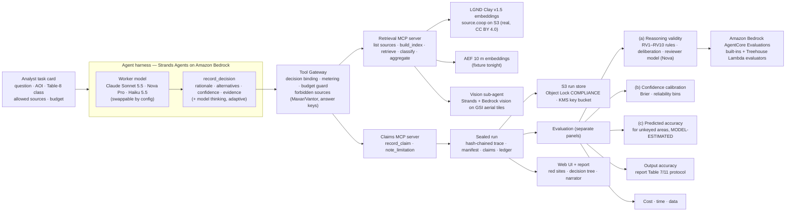

# Treehouse architecture and AWS integration

**One line:** an ADB analyst asks "where are all the <assets> in this area?"; an agent on Amazon Bedrock answers by
choosing foundation-model resources (Clay, AEF, a vision model); Treehouse records every decision the agent makes,
judges whether each decision's *why* was valid and whether its confidence was earned, and scores the output it produced —
all sealed in tamper-evident AWS storage.

This page is the presentation reference. Every row says whether it **ran live**, is **built and tested offline**, or is
**designed** (roadmap). Claims link to committed evidence.

## 1. System at a glance

## 2. AWS services — what each does and its status

| Service | Role in Treehouse | Status | Evidence |
|---|---|---|---|
| **Amazon Bedrock** (Converse) | Worker models Claude Sonnet 5.5, Nova Pro, Haiku 5.5; vision model for the sub-agent; Sonnet *adaptive thinking* | **Ran live** — 18+ agent runs; Haiku and adaptive thinking verified 2026-11-05 | `fixtures/live/cassettes/`, `.spend/spend.jsonl` |
| **Strands Agents** (AWS open source) | The agent loop under evaluation; also the vision sub-agent | **Ran live** | `fixtures/live/runs/`, `docs/design/STRANDS.md` |
| **Amazon Bedrock AgentCore Evaluations** | Built-in ToolSelectionAccuracy, ToolParameterAccuracy, TrajectoryInOrderMatch, GoalSuccessRate on the run's spans, plus Treehouse **code-based Lambda evaluators** (`treehouse_rules`, `treehouse_guard`) | **Ran live** | `fixtures/live/agentcore/` |
| **AgentCore Observability / CloudWatch Transaction Search (X-Ray)** | Span store the evaluators read; OTel-GenAI span shape (`invoke_agent` / `chat` / `execute_tool`) | **Enabled live** | `docs/KIRO-STATUS.md` task 0 |
| **AWS Lambda** | Treehouse rule and guard evaluators deployed as AgentCore code-based evaluators | **Deployed live (CDK)** | `infra/cdk-outputs.json` |
| **Amazon S3 Object Lock (COMPLIANCE)** | Every sealed run is write-once; even the account admin cannot delete a locked version | **Ran live** — admin delete **denied** | `fixtures/live/receipts/denied-delete.json` |
| **AWS KMS** + bucket policy | Grading keys live in a separate KMS-encrypted bucket with an explicit Deny for the worker role, so the agent can never read the answer key | **Deployed live (CDK)** | `infra/treehouse_infra.py` |
| **AWS CDK** (IaC) | Two stacks: `RunStoreStack`, `EvalStack`; reproducible in any account | **Deployed live** | `infra/` |
| **AWS Open Data (source.coop on S3)** | Real LGND Clay v1.5 embeddings read anonymously with bounded range reads | **Ran live** (real index: 53 × 1,280 m cells, scene S2B_53SPU_20240419) | PR #29, `tasks/t1-nagoya-warehouses-real.yaml` |
| **Amazon Polly** (neural) | Narrator for the web report (accessibility) | **Verified live**; UI wiring in progress | Workshop probe 2026-11-05 |
| **AWS RODA MCP server** | Open-data discovery tool for the agent (Clay's Day-1 guidance) | Designed / package queued | `docs/EXTERNAL-DEPENDENCIES.md` |
| **AgentCore Runtime + online evaluation** | Host the agent and score every production run continuously | Designed | §5 |
| **AWS Step Functions Distributed Map** | Fan-out of experiment matrices (model × classifier × area × N) | Designed | §5 |
| **Amazon Athena / S3 Vectors** | Search over very large embedding catalogues (> 1M vectors); local search below that | Designed (local path built) | `src/treehouse/tools/search_agent.py` |
| Bedrock batch inference | — | **Not used**: denied in the workshop account | `aws-capabilities.json` |

## 3. Why these choices (short defence)

- **Strands + Bedrock, not a custom loop:** the thing being evaluated should be a real, widely used agent framework;
  model and harness stay swappable by run config (Clay requirement).
- **AgentCore Evaluations + our own Lambda evaluators:** AWS-native trajectory and tool-use scoring, extended with
  domain rules (scale fit, imagery licence, held-out isolation) that no generic evaluator knows.
- **Object Lock COMPLIANCE, not Governance:** an evaluation is only trustworthy if nobody — including us — can rewrite
  a run after seeing its score. The denied admin delete is the proof.
- **Separate key bucket with a worker Deny:** the agent physically cannot reach the answer key; isolation is enforced
  by IAM, not by prompt.
- **Three scores never blended:** reasoning validity, calibration and predicted accuracy answer different questions;
  blending them would hide exactly the failures ADB needs to see.
- **Real public data, honestly labelled:** LGND Clay embeddings are real; where a source could not be read from the
  workshop (AEF, PLATEAU) the fixture is labelled synthetic in every output.

## 4. What Treehouse judges in one decision

For a decision like "build the index from AEF at 160 m, not Clay at 1,280 m" Treehouse records the parameters, the
rationale, the alternatives the agent says it considered, its confidence and (with adaptive thinking) the model's thinking
text. It then checks: **RV1 scale fit** (cell size vs the asset's registry size), **RV2 licence**, **RV3 resolution**,
held-out isolation, coverage, claims-vs-evidence, honest limits, revision quality; and **deliberation** — did it actually
compare options, verify, and revise before stating high confidence, or was the confidence unearned? Self-reported
rationale and thinking are evidence of what the agent said, not proof of its internal computation.

Live example (`live-nagoya-real-sonnet-2`, real Clay data offered): the agent chose AEF at 160 m because "Clay 1280 m [is]
too coarse" for ~40 m warehouses, found no labelled examples, could not reach imagery, recorded the limitation and made
one honest `cannot_assess` claim rather than guessing.

## 5. Scaling path (designed)

1. **Host the agent on AgentCore Runtime**; turn on **online evaluation** so every production run is scored by the same
   built-in and Lambda evaluators.
2. **Experiment fan-out with Step Functions Distributed Map** (one child per model × classifier × area × trial), each
   child sealing to the same Object Lock store; metering stays in the Tool Gateway.
3. **Large-scale retrieval** over Clay's 15B+ embeddings with Athena (GeoParquet) or S3 Vectors; the agent's choice of
   index stays a judged decision.
4. **Portable deployment:** the CDK app parameterises account, region and lock mode; nothing is hard-wired to the
   workshop account.

## 6. Honest limits

- Accuracy numbers from the experiment matrix are on synthetic fixtures (AEF/PLATEAU were unreachable from the workshop);
  only the LGND Clay path is real.
- The vision sub-agent is tested offline and wired for live runs; live agents have not yet chosen it on their own.
- Predicted accuracy (score c) has too few configurations for a validated interval; it is labelled MODEL-ESTIMATED.
